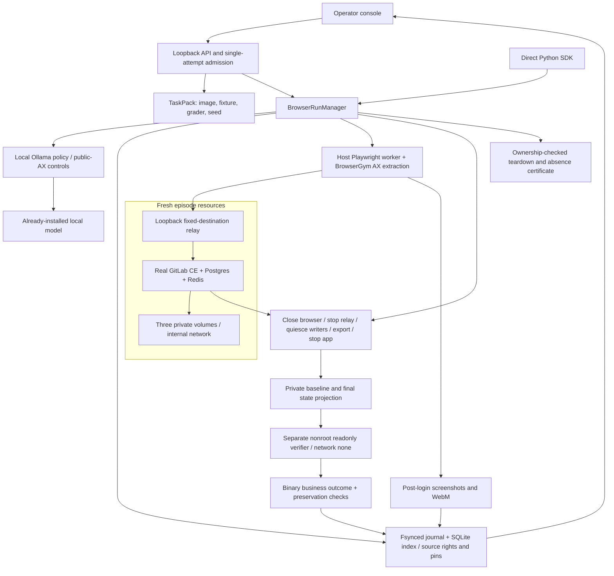

# Real GitLab browser environments

This is the phases 1--3 local implementation: versioned task/runtime contracts,
a real GitLab application with detached persisted-state grading, and a browser
operator console plus Python SDK. Older Python worlds remain available as
**simulation diagnostics**. They are not evidence of browser fidelity.
The [dated results and media guide](gitlab-browser-results.md) includes the actual
successful reference, failed model attempt, timings and desktop/mobile QA.

## Architecture



The operator owns the controller and Docker daemon. The policy gets only the
public task, current URL/title, a bounded accessibility tree and prior public
actions/results. It cannot call Rails, SQL, shell, arbitrary JavaScript, private
state, or the verifier. Screenshots are operator evidence; this first text-model
adapter does **not** send their pixels to the model.

The [browser context diagnostic protocol](gitlab-model-loop-protocol.md) separates
model strength from the action/result context repair. Historical collection
protocols describe their pinned revisions. New experiments require their own
committed source, exact model identity and fresh evidence; they do not replace
prior failed attempts or establish training improvement.

The application is real software, not a hand-written text state machine. Agent
actions navigate real pages and commit changes through the ordinary GitLab UI.
The task asks the agent to discover a project, distinguish identically titled
issues by their descriptions, post an exact comment, and close the correct
issue without changing other issues, history or access. It is one original local
fixture, not an imported WebArena benchmark or a production workload sample.

## Start Locally

Use a local Unix Docker daemon, enough Docker VM memory for a 4 GiB GitLab
container plus the daemon, and Python 3.11 or 3.12 for the pinned optional browser
dependencies. The default Python-only installation still works without them;
BrowserGym's pinned transitive greenlet dependency does not build on Python 3.13.

```sh
UV_PROJECT_ENVIRONMENT=.world-engine/browser-venv uv sync --python 3.12 --extra dev --extra browser
.world-engine/browser-venv/bin/python -m playwright install chromium ffmpeg
```

The approved local pilot pins native ARM64 GitLab CE 19.4.1. Runtime preparation
requires these images to exist locally and will not pull them automatically:

```sh
docker pull gitlab/gitlab-ce@sha256:7fff8748a25202c1d38885797510afe055f555856f3f50c2b17466a853be5d24
docker pull python@sha256:a1165e272e578941b84abc79e4ab38a0305cd12803a5c4247979ac7655f4d641
WORLD_ENGINE_BROWSER_ENABLED=1 .world-engine/browser-venv/bin/python -m world_engine serve
```

An existing compatible Chromium may be selected explicitly with
`WORLD_ENGINE_BROWSER_EXECUTABLE_PATH`; its version and executable hash are
recorded. The pilot uses cached Chromium 156 with Playwright 1.44 and BrowserGym
0.14.3. A different architecture/browser needs its own tested pins and receipt,
not an assertion that this ARM collection proves compatibility everywhere.

Start the console with `npm run dev` in `web`, then open
[Browser Environments](http://127.0.0.1:5173/#browser-environments).
An admitted attempt checks application and model prerequisites during
preparation. "Runtime enabled" is not a preflight promise. Model mode requires an
already-installed tool-capable Ollama model; no model is downloaded and no paid
provider is available in the browser contract. Controls exercise the environment
and grader, not learned-model ability.

## SDK and Evidence

```sh
.world-engine/browser-venv/bin/python examples/gitlab_browser.py --plan --output artifacts/my-gitlab-plan
.world-engine/browser-venv/bin/python examples/gitlab_browser.py --provider browser-reference --output artifacts/my-fresh-gitlab-control
.world-engine/browser-venv/bin/python scripts/collect_gitlab_browser.py --output artifacts/my-fresh-gitlab-cohort
```

The SDK example constructs `BrowserStore`, `GitLabRuntime`, `BrowserGymDriver`,
`create_browser_policy` and `BrowserRunManager`. Custom adapters implement the
explicit protocols in `browser_contracts.py`, not the old synthetic-world API.
Its `--task-id` selects a registered pack; omitted means `gitlab-issue-close`.
The separate [release-readiness contract](gitlab-readiness.md) adds ready and
blocked development cases. Its source tests do not establish physical
qualification, and the existing fixed collectors do not collect this new pack.
Runtime owns application allocation/sealing/grading/cleanup; driver owns browser
observations/actions/media; policy owns inference. A policy must install the
manager's recorder before inference so request intent is durable before calls.

The last command uses the running loopback API and the
[fixed collection protocol](gitlab-browser-protocol.md). It requires committed
unchanged source, refuses existing output, runs fresh instances in a declared
order, retains rejected API/model replies and stops after failed qualification.
It does not retry or convert a reference success into a model success.

Browser history is separate from legacy engine SQLite. Each attempt has a
hash-chained journal, registered integrity-checked public media, immutable task
pins, exact model input/raw complete replies, partial transport failure evidence,
timing, terminal reason, seal hash and cleanup. Private sealed state is **not**
served by artifact routes. Browser episodes are evaluation-only and cannot be
exported as SFT, DPO or GRPO training data. In particular, Ollama text replies are
not exact sampled-token/logprob trainer batches.

For read-only console QA, use `node scripts/browser-console-qa.mjs --plan`, then
its explicit committed-source/attempt/fresh-output arguments. It creates no
attempts or inference calls and records desktop, 390px and 360px views plus a
console video. Rollout media and console QA recordings are separate artifacts.
The QA browser grants local-network access only to the selected loopback UI
origin, permits that preview's root-path Vite HMR socket, and blocks other
destinations. Its receipt distinguishes HTTP GETs from preview sockets and
requires actual video decoding and advancing playback; browser errors still fail
acceptance. Diagnostic WebSocket tokens must remain private or be explicitly
redacted in a public copy.
With local FFmpeg/ffprobe installed, `scripts/check_browser_video.py` decodes
three timestamped frames and checks nonblank pixels; use `--require-motion` for
the active reference/model recordings, then inspect the frames visually. Its
fresh output and video hash preserve which exact recording was checked.

## Grading and Limits

After browser/video closure, ingress and application writers stop. Rails exports
baseline/final projections of projects, project features, namespaces, public
account facts, members, issues, notes, labels/links and state events. The verifier
reads sealed JSON over stdin in its own network-disabled, readonly, nonroot,
capability-dropped container with no host socket, app mounts or credentials.
It checks exact comment/closure actor and ordering, prior-history preservation,
unrelated issues and access. This is a covered-table projection, **not** a
certificate over every GitLab feature or table.

Each episode has fresh volumes, accounts, networks and browser context. GitLab
has no default internet route; a constrained relay forwards only to its fixed
app address. Playwright restricts HTTP requests to the exact loopback app origin, denies
administrative/API document navigation, and exposes only observed visible node
IDs. Login is outside recording/model input. The verifier remains outside the
agent interface even if an agent changes its own page content.
Credential-management, runner-registration and project/group settings namespaces are denied for all
browser requests, including SPA requests, to prevent newly generated tokens
entering video or observations. Those workflows are outside this task's fidelity.
Token-bearing query URLs are also denied. AX hyperlink URL properties are omitted
using BrowserGym's formatter; the current safe page URL, names and node IDs remain.
This does not certify universal secret detection across arbitrary applications.

This is a **trusted-operator local Docker pilot**, not gVisor, a microVM fleet,
or tenant-safe hosted execution. The host browser's isolation is not a guest VM.
HTTP routing is not an OS-level boundary or a guarantee over every browser transport.
The current Docker daemon's raw-iptables warning prevents a network-security
certification. A synchronous browser thread can outlive a cooperative deadline;
uncertain closure, cleanup or journal finalization blocks further admission.
Recovery requires manual owned-resource reconciliation, not optimistic resume.
There is no daemon-enforced TTL after a controller/host crash, hard media disk
quota, authenticated console, snapshot fork, exact replay, distributed scheduler
or measured high-concurrency browser throughput.

## Remaining Gates

World Engine separates environment transitions, rollout, grading and storage.
The browser path adds a distinct real-application lifecycle; a synthetic tool
transition is not a browser action. Instance identity, task versions and durable
rollout evidence remain explicit across those boundaries. Inference and sandbox
rollouts exist locally; sampled-token training batches and model updates do not.
The [engineering guide](engineering-guide.md) describes these contracts.

Next gates are a killable isolated browser worker, host-crash reconciliation/TTL,
more original varied tasks, a second real application, covered-state parity
audits, and a fixed diverse-image concurrency experiment. Warm image caching,
checkpoint/fork and scheduler work should follow those measurements, not replace
correctness and evidence with speculative speed claims.
